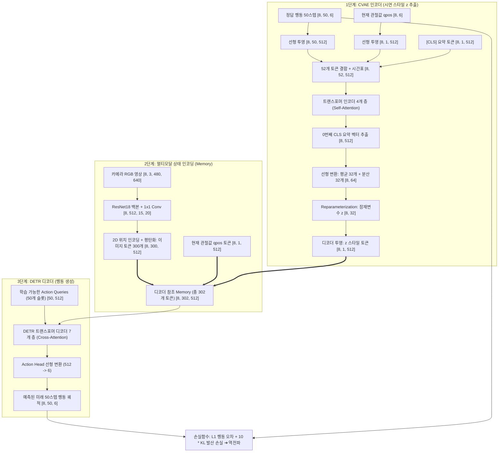
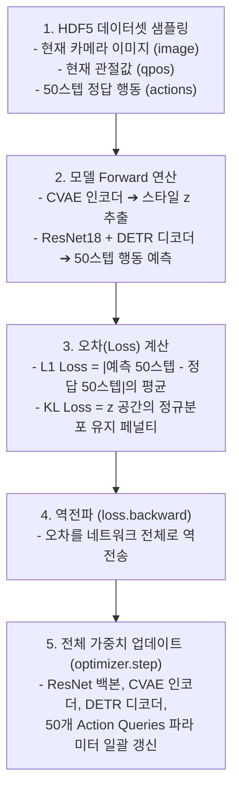

# Action Chunking with Transformers (ACT) 아키텍처 및 CVAE 인코딩 완벽 가이드

> **작성일**: 2026-10-14  
> **대상 프로젝트**: SO-101 로봇팔 모방학습 (`Robot_Arm_Project/act`)  
> **핵심 키워드**: `Action Chunking`, `CVAE (Conditional VAE)`, `Transformer Encoder/Decoder`, `DETR`, `Temporal Ensembling`, `STS3215`

---

## 1. Action Chunking with Transformers (ACT) 개요

* **ACT(Action Chunking with Transformers)**는 멀티모달 카메라 관측과 현재 로봇 관절 상태를 기반으로, 인간의 시연 스타일을 CVAE로 모델링하고 미래 일련의 행동 궤적(Action Chunk)을 한 번에 생성하는 최신 로봇 조작 파운데이션 모방학습 프레임워크입니다.

### ✴️ 기존 방식(단일 스텝 회귀) vs ACT 비교

| 항목 | 기존 MLP/RNN 기반 정책 (BC) | ACT (Action Chunking with Transformers) |
| :--- | :--- | :--- |
| **출력 방식** | 단일 시점의 액션값(1스텝) 직접 회귀 | 50스텝 미래 궤적을 덩어리(Chunk)로 일괄 생성 |
| **다중 해법 (Multimodal)** | 두 갈래 길(좌/우 회피)의 평균을 내어 충돌 발생 | CVAE 잠재변수 z를 통해 시연 스타일을 완벽히 분리 |
| **누적 오차 (Compounding)** | 시간 경과에 따라 미세 오차가 기하급수적으로 누적 | 궤적 단위 예측 및 시간축 앙상블로 오차 상쇄 |
| **제어 품질** | 모터 지터링(Jitter, 덜덜 떨림) 발생 | 사람 손동작처럼 부드럽고 연속적인 곡선 궤적 형성 |

---

## 2. 전체 파이프라인 아키텍처 다이어그램



---

## 3. CVAE 인코더 상세 분석 (학습 데이터 인코딩)

### 3.1. 52개 입력 토큰의 조립 과정
* **CLS 토큰 (1개)**: 전체 행동 궤적의 스타일을 압축해 담을 빈 그릇 (`[8, 1, 512]`)
* **qpos 토큰 (1개)**: 현재 시점 t의 로봇 관절 상태 (`Linear(6, 512)` ➔ `[8, 1, 512]`)
* **행동 토큰 (50개)**: 미래 t+1 ~ t+50 시점의 정답 행동 궤적 (`Linear(6, 512)` ➔ `[8, 50, 512]`)
* **시간 위치 인코딩**: 0번(CLS), 1번(현재), 2~51번(미래) 각 자리에 1D Sinusoidal Position Embedding 부여
* **⚠️ 주의**: CVAE 인코더에는 이미지가 들어가지 않으며, 학습 속도를 위해 관절값과 행동 궤적만 들어갑니다.

### 3.2. 트랜스포머 인코더 4개 층의 Self-Attention 메커니즘
* **52개 전 토큰 QKV 연산**: 52개 모든 토큰이 동등하게 Query, Key, Value로 투영되어 `[52 x 52]` 상호 어텐션 맵을 형성
* **점진적 추상화 (1번 vs 4번의 차이)**:
  * 1층: 바로 앞뒤 스텝 간의 미세한 관절 각속도 및 순간 변화량 포착
  * 2~3층: 단기 모션 프리미티브 및 시작점부터 끝점까지의 전체 이동 방향 파악
  * 4층: 전체 50스텝을 관통하는 고수준의 작업 스타일("장애물을 피해 위로 접근")이 `[CLS]` 토큰에 최종 흡수
* **CLS 0번째 토큰 슬라이싱**: 4개 층 통과 후 0번째 CLS 벡터(`[8, 512]`) 하나만 추출하여 스타일을 정의함

### 3.3. 차원 변화의 핵심 이유 (`512 ➔ 64 ➔ 32 ➔ 512`)
* **512 ➔ 64**: 32차원 정규분포를 정의하기 위해 평균 32개와 분산 32개 생성
* **64 ➔ 32 (Reparameterization)**: `z = mu + std * eps` 공식으로 1개의 잠재벡터 z 샘플링 (**정보 병목 효과**로 불필요한 노이즈 제거)
* **32 ➔ 512**: 디코더의 다른 토큰들(영상 300개, 관절값 1개)과 내적 어텐션 연산을 수행하기 위해 512 규격으로 재확장

---

## 4. DETR 디코더의 상세 동작 메커니즘

### 4.1. 디코더 입력 2요소 (Memory vs Query)
* **지식 저장소 (Memory, 총 302개 토큰)**:
  1. 카메라 이미지 토큰: `[8, 300, 512]` (ResNet-18 통과 후 300개 패치로 변환)
  2. 현재 관절값 qpos 토큰: `[8, 1, 512]` (로봇의 현재 자세)
  3. 스타일 z 토큰: `[8, 1, 512]` (CVAE 인코더가 뽑아준 이번 시연의 의도)
  * ➔ `torch.cat` 결합: **`[8, 302, 512]`**
* **행동 질문지 (Action Queries, 총 50개 슬롯)**:
  * `self.query_embed = nn.Embedding(50, 512)` ➔ **`[50, 512]`**
  * 미래 50스텝의 각 시점(0.02초 뒤 ~ 1.0초 뒤)을 나타내는 학습 가능한 고유 벡터

### 4.2. 디코더 7개 층 내부의 3단계 블록
디코더 7개 층은 각각 아래 3단계를 순차적으로 실행합니다:
1. **Self-Attention (쿼리끼리 상호 조율)**:
   * 50개의 슬롯끼리 서로 어텐션을 주고받으며, 행동들이 시간 순서상 뚝뚝 끊기지 않고 부드러운 곡선 궤적이 되도록 조율
2. **Cross-Attention (Memory 302개 참조)**:
   * 50개의 슬롯이 302개의 Memory를 동시에 쳐다보며, 화면 속 물체 위치와 현재 관절 각도, 그리고 스타일 $z$에 맞는 각도를 찾아냄
3. **Feed-Forward MLP (비선형 융합)**:
   * 512차원을 3200차원으로 확장했다가 다시 512차원으로 압축하여 복잡한 물리적 관계를 고차원으로 학습

### 4.3. Action Head 선형 투영 및 병렬 출력
* 7개 층을 통과한 50개 슬롯(`[8, 50, 512]`)을 마지막 선형 계층(`Linear(512, 6)`)에 통과시킴
* **최종 출력**: **`[8, 50, 6]`** (한 번에 50타임스텝의 6개 관절 목표 각도를 병렬 일괄 출력)

---

## 5. 1회 학습 이터레이션(Iteration)의 전체 루프



### 5.1. 데이터로더 샘플링 (Batch = 8)
* 에피소드 데이터에서 임의의 시점 $t$를 골라 **현재 이미지**, **현재 qpos**, 그리고 $t \sim t+49$ 동안 실제로 사람이 움직였던 **50스텝 정답 actions**를 묶어 모델에 전달

### 5.2. 손실 함수(Loss) 계산 및 역전파
* **L1 Loss**: 모델이 예측한 50스텝(`[8, 50, 6]`)과 실제 사람의 50스텝 정답(`[8, 50, 6]`) 간의 절대 오차 평균
* **KL Loss**: CVAE의 잠재변수 $z$가 표준정규분포 $\mathcal{N}(0, I)$를 따르도록 제어 (가중치: 10)
* **`loss.backward()` 실행**: 역전파가 일어나며 **ResNet18, CVAE 인코더, DETR 디코더, 50개 Action Queries**의 모든 가중치가 한꺼번에 업데이트됨

---

## 6. 손실 함수(Loss) 및 활성화 함수(Activation) 상세 분석

### 6.1. 손실 함수 (Loss Function)
손실 함수는 **행동 복원 손실(L1 Loss)**과 **CVAE 정규화 손실(KL Divergence)**의 가중치 합으로 계산됩니다:
* **총 손실 공식**: $\text{Total Loss} = \text{L1 Loss} + 10 \times \text{KL Loss}$

1. **행동 복원 손실: L1 Loss (MAE)**
   * `all_l1 = F.l1_loss(actions, a_hat, reduction='none')`
   * `l1 = (all_l1 * ~is_pad.unsqueeze(-1)).mean()`
   * **L2(MSE) 대신 L1을 채택한 이유 (논문 Section IV-C)**: 일반적인 L2(MSE) 손실은 오차가 작아질수록 기울기가 급격히 줄어들어 정밀 제어에 둔감해집니다. 반면 **L1 손실은 오차 크기에 상관없이 일정한 기울기를 유지하므로 밀리미터(mm) 단위의 정밀한 그리퍼 위치 결정을 훨씬 정교하게 학습**합니다.
2. **잠재공간 정규화 손실: KL Divergence**
   * $D_{\text{KL}}\left(\mathcal{N}(\mu, \sigma^2) \parallel \mathcal{N}(0, I)\right) = -\frac{1}{2} \sum \left(1 + \log(\sigma^2) - \mu^2 - \sigma^2\right)$
   * CVAE 인코더가 만들어낸 잠재변수 $z$ 공간이 과도하게 벌어지거나 특정 샘플을 단순 암기하지 못하도록 표준정규분포 $\mathcal{N}(0, I)$ 형태로 묶어주는 페널티 역할을 합니다. (가중치 $\beta=10$)

### 6.2. 활성화 함수 (Activation Function)
1. **은닉층: ReLU (`activation="relu"`)**
   * 트랜스포머 인코더/디코더 내부의 Feed-Forward MLP 계층(`Linear 512 ➔ 3200 ➔ ReLU ➔ Linear 3200 ➔ 512`)에서 사용됩니다.
   * ResNet-18 비전 백본의 모든 합성곱(Conv) 계층 뒤에도 표준 **ReLU**가 사용됩니다.
2. **최종 출력층(Action Head): 활성화 함수 미사용 (Linear / Identity)**
   * `self.action_head = nn.Linear(hidden_dim, state_dim)`
   * 로봇의 관절 각도는 음수/양수를 아우르는 연속적인 실수값(라디안)을 표현해야 하므로, Sigmoid나 Tanh 등으로 범위를 제한하지 않고 **선형 변환 결과값을 그대로 출력**합니다.

### 6.3. 손실 및 활성화 함수 요약표

| 구분 | 함수명 | 적용 위치 | 핵심 목적 및 효과 |
| :--- | :--- | :--- | :--- |
| **행동 손실** | **L1 Loss (MAE)** | 최종 예측 행동 vs 정답 행동 | L2 대비 미세 오차에 민감하여 정밀 조작 성능 대폭 향상 |
| **정규화 손실** | **KL Divergence** | CVAE 잠재변수 $z$ 분포 | $z$ 공간을 $\mathcal{N}(0, I)$로 정규화 (가중치 $\beta=10$, 정보 병목 유지) |
| **은닉층 활성화** | **ReLU** | ResNet 및 트랜스포머 MLP | 풍부한 비선형 특징 추출 및 빠른 연산 속도 확보 |
| **출력층 활성화** | **없음 (Linear)** | Action Head 최종 출력단 | 실수 영역의 연속적인 목표 관절 각도를 왜곡 없이 출력 |

---

## 7. 텐서 차원(Shape) 변화 단계별 총정리

| 번호 | 파이프라인 단계 | 사용 모듈 | 입력 크기 | 출력 크기 | 핵심 역할 |
| :---: | :--- | :--- | :---: | :---: | :--- |
| **1** | 행동 데이터 임베딩 | `nn.Linear(6, 512)` | `[8, 50, 6]` | `[8, 50, 512]` | 6차원 행동 50개를 512차원으로 투영 |
| **2** | 현재 관절값 임베딩 | `nn.Linear(6, 512)` | `[8, 6]` | `[8, 1, 512]` | 현재 관절값 1개를 512차원으로 투영 |
| **3** | 시퀀스 결합 및 패딩 | `torch.cat` | CLS(1) + qpos(1) + act(50) | `[8, 52, 512]` | 52개 토큰 결합 및 1D 시간표 부여 |
| **4** | 인코더 상호작용 | 4 Layers Transformer | `[8, 52, 512]` | `[8, 52, 512]` | Self-Attention 후 0번째 CLS 추출 (`[8, 512]`) |
| **5** | 잠재분포 생성 | `nn.Linear(512, 64)` | `[8, 512]` | `[8, 64]` | 평균 32개 + 분산 32개 생성 |
| **6** | 잠재변수 추출 | Reparameterization | `[8, 64]` | `[8, 32]` | 32개 숫자로 스타일 압축 (정보 병목) |
| **7** | 디코더용 z 투영 | `nn.Linear(32, 512)` | `[8, 32]` | `[8, 1, 512]` | 디코더 어텐션 규격(512)으로 확장 |
| **8** | 카메라 특징 추출 | ResNet18 + 1x1 Conv | `[8, 3, 480, 640]` | `[8, 512, 15, 20]` | 15 x 20 = 300개 패치로 공간 정보 압축 |
| **9** | 영상 토큰화 | 2D Pos Embedding | `[8, 512, 15, 20]` | `[8, 300, 512]` | 300개의 512차원 이미지 토큰으로 변환 |
| **10** | 디코더 Memory 결합 | `torch.cat` | 영상(300) + qpos(1) + z(1) | `[8, 302, 512]` | 디코더 참조용 총 302개 지식 기반 구축 |
| **11** | DETR 디코더 연산 | 7 Layers Cross-Attention | Query `[50, 512]` vs Memory | `[8, 50, 512]` | 50개 쿼리가 302개 토큰을 참조하여 디코딩 |
| **12** | 최종 액션 헤드 | `nn.Linear(512, 6)` | `[8, 50, 512]` | `[8, 50, 6]` | 미래 50스텝 목표 관절 각도 일괄 출력 |

---

## 8. 학습(Training) vs 추론(Inference) 동작 비교

* **학습 시 (Training)**:
  * 사람이 시연한 정답 50스텝 행동을 CVAE 인코더에 입력하여 실제 시연의 잠재 스타일 z를 추출
  * 손실 함수: 예측값과 정답 간의 L1 오차 + 잠재공간 정규화를 위한 KL 발산 손실(가중치: 10)
* **추론 시 (Inference)**:
  * 미래 행동 정답이 없으므로 CVAE 인코더는 완전히 OFF
  * 표준 정규분포의 평균값인 **z = 0 (고정 텐서)**을 디코더에 주입하여 가장 안정적이고 표준적인 행동 궤적을 자율 실행

---

## 9. SO-101 (6자유도) 실전 코드 수정 가이드

기존 14자유도(ALOHA 양팔) 코드를 SO-101(단일 팔 6자유도)로 개조할 때 수정해야 하는 핵심 위치 3곳:

```python
# 파일 위치: act/detr/models/detr_vae.py

# 1. CVAE 인코더: 정답 행동 입력 차원 변경 (14 -> 6)
self.encoder_action_proj = nn.Linear(6, hidden_dim)

# 2. CVAE 인코더: 현재 로봇 관절값 입력 차원 변경 (14 -> 6)
self.encoder_joint_proj = nn.Linear(6, hidden_dim)

# 3. 디코더 최종 출력 헤드 차원 변경 (14 -> 6)
self.action_head = nn.Linear(hidden_dim, 6)
```
