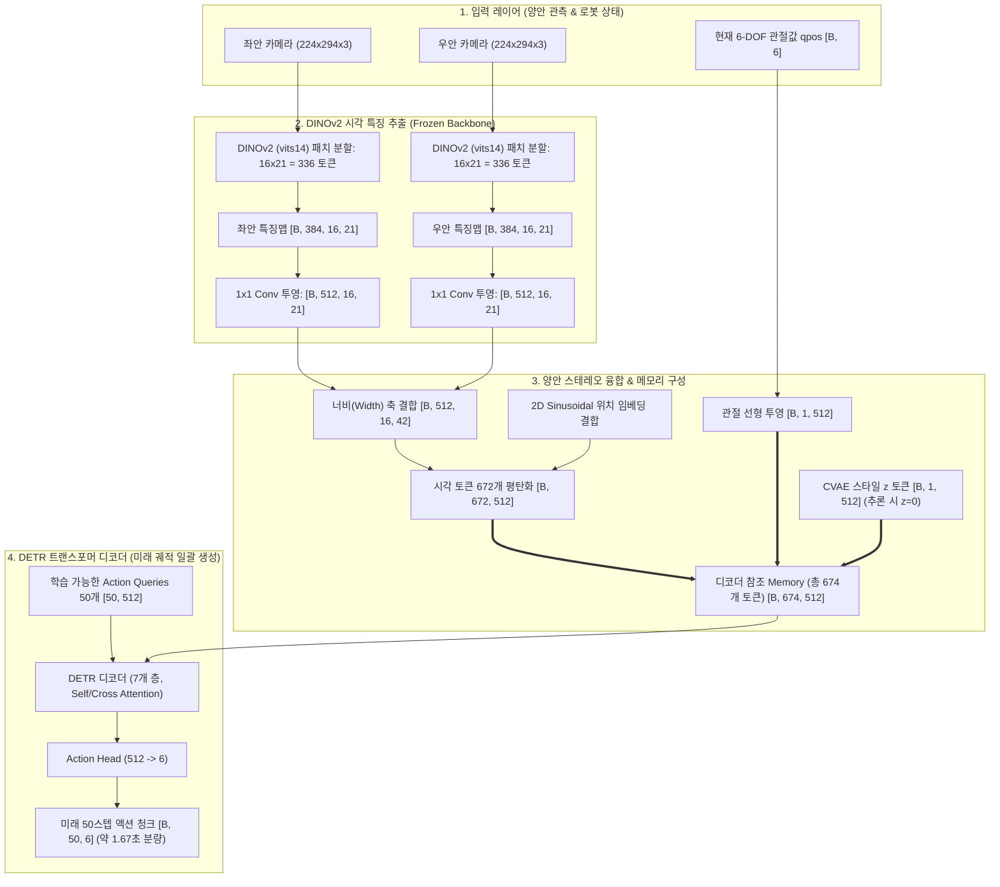

# DINOv2 기반 양안(Dual-Eye) ACT 아키텍처 및 동작 원리 가이드

> **작성일**: 2026-10-28  
> **대상 모듈**: `models/so101_dual_dinov2_act`  
> **핵심 키워드**: `DINOv2`, `ViT (Vision Transformer)`, `ACT (Action Chunking with Transformers)`, `Dual-Eye Stereo Fusion`, `CVAE`, `Temporal Ensembling`

---

## 1. 개요 및 도입 배경 (Why DINOv2 + Dual-Eye?)

기존의 모방학습(Imitation Learning) 프레임워크인 ACT는 주로 **ResNet-18** 백본과 단안(Monocular) 카메라를 사용했습니다. 그러나 실제 로봇 매니퓰레이션 환경에서는 다음과 같은 문제점이 존재했습니다:

1. **공간 깊이감(Depth) 인식의 부재**: 단안 2D 이미지만으로는 타겟 물체(예: 탁구공)와의 물리적 거리, 그리퍼와 물체 사이의 Z축 상대 거리를 정밀하게 추정하기 어렵습니다.
2. **CNN 백본의 로컬 특징 한계**: ResNet-18은 국소 영역(Local receptive field)의 텍스처나 윤곽선에 치중되어, 복잡한 배경, 그림자, 조명 변화에 취약하고 작업대 전역의 기하학적(Geometric) 관계를 파악하기 어렵습니다.
3. **사전학습 표현력의 한계**: ImageNet 라벨 분류 위주로 지도학습된 CNN 가중치는 로봇 조작에 필요한 물체 부위별 의미론적(Semantic) 특징을 충분히 담지 못합니다.

이 문제를 해결하기 위해 **Meta의 DINOv2 (Vision Transformer 파운데이션 모델)**와 **좌/우 양안(Dual-Eye) 카메라 시스템**을 결합한 **`so101_dual_dinov2_act`**를 구축했습니다.

---

## 2. 전체 아키텍처 다이어그램



---

## 3. 핵심 기술 요소 상세 분석

### 3.1 DINOv2 패치 정합 (Patch Alignment) 및 해상도 최적화
- **DINOv2 패치 규격**: ViT 기반 모델로 모든 입력 이미지는 패치 크기인 **14의 배수**여야 합니다.
- **해상도 선정**: 원본 카메라 해상도 `480x640` (비율 약 3:4)의 종횡비를 왜곡 없이 보존하기 위해 $224 \times 294$ 해상도를 채택했습니다.
  $$\text{Height} = 14 \times 16 = 224, \quad \text{Width} = 14 \times 21 = 294$$
- **토큰 수**: 카메라 1대당 $16 \times 21 = 336$개의 패치 토큰이 생성됩니다.

### 3.2 DINOv2가 통과 후 갖게 되는 정보
DINOv2는 비지도 자기지도학습(DINO + iBOT Loss)을 통해 사전학습된 모델로, 통과 후 `x_norm_patchtokens`는 다음과 같은 풍부한 정보를 담고 있습니다:
1. **의미론적 세분화 (Semantic Segmentation) 능력**: 작업대 위에서 타겟 물체(예: 탁구공), 로봇 팔의 그리퍼 팁, 장애물, 배경 바닥을 명확히 구분하는 클러스터링 특성을 가집니다.
2. **시점 불변성 및 외형 강건성**: 조명 반사, 그림자 변화, 미세한 시점 차이에도 물체 고유의 임베딩 거리가 안정적으로 유지됩니다.
3. **내재적 기하/깊이(Geometric/Depth) 정보**: 픽셀 간 어텐션 맵에 3D 공간 상의 원근감과 상대적 거리 정보가 인코딩되어 있어, 별도의 3D 포인트 클라우드 없이도 공간적 상호작용 추론이 가능합니다.
4. **가중치 고정 (Frozen Backbone)**:
   - `train_backbone = False`로 설정하여 DINOv2의 강력한 시각 표현력을 보존하고 오버피팅을 방지합니다.
   - 역전파 계산량이 대폭 감소하여 학습 속도가 빨라지고 GPU 메모리 효율이 극대화됩니다.

### 3.3 양안(Dual-Eye) 스테레오 특징 결합 메커니즘
- 좌안(`cam_left`)과 우안(`cam_right`) 카메라에서 추출된 특징 맵 $(B, 512, 16, 21)$ 2개를 가로(Width) 축으로 연결합니다:
  $$\text{Feature Map} = \text{Concat}(\text{Feat}_{\text{left}}, \text{Feat}_{\text{right}}, \text{dim}=3) \implies (B, 512, 16, 42)$$
- 2D Sinusoidal 위치 임베딩도 동일하게 가로축으로 결합되어 디코더에 제공됩니다.
- **장점**: 트랜스포머의 Self/Cross-Attention 메커니즘이 좌안의 특정 패치와 우안의 대응되는 패치 간의 시차(Disparity)를 스스로 비교(Epipolar 기하학적 관계 학습)하여 타겟의 3차원 위치를 정밀하게 파악합니다.

### 3.4 CVAE (Conditional Variational Autoencoder)
- **학습 시 (Training)**:
  - 사람의 시연 데이터에서 미래 50스텝 액션과 현재 상태 $q_{\text{pos}}$를 인코더에 입력하여 잠재 변수 $z \sim \mathcal{N}(\mu, \sigma^2)$ (32차원)를 샘플링합니다.
  - 사람마다 또는 시도마다 다를 수 있는 조작 스타일(접근 궤적, 속도 등)을 $z$ 공간에 분리 모델링합니다.
- **추론 시 (Inference)**:
  - $z = \mathbf{0}$ (평균 스타일)으로 고정하여 결정론적(Deterministic)이고 가장 안전하며 표준적인 궤적을 일관되게 생성합니다.

### 3.5 Action Chunking & Temporal Ensembling
- **Action Chunking (50스텝)**:
  - 단일 스텝 회귀 방식의 누적 오차(Compounding Error) 및 지터링(Jitter)을 방지하고, 50스텝(약 1.67초) 분량의 연속적인 궤적을 한 번에 생성합니다.
- **시간축 앙상블 (Temporal Ensembling)**:
  - 매 타임스텝마다 새로 예측된 50스텝 청크와 과거 스텝에서 예측해 둔 궤적들의 중첩 구간을 지수 가중치($m=0.02$)로 가중 평균합니다:
    $$w_i = \exp(-m \cdot i)$$
  - 이를 통해 모터 제어 명령의 급격한 튐 없이 극도로 부드럽고 자연스러운 동작을 구현합니다.

---

## 4. 기존 ACT (ResNet-18) vs DINOv2 Dual-Eye ACT 비교

| 비교 항목 | 기존 ACT (`so101_act`) | 개선된 DINOv2 양안 ACT (`so101_dual_dinov2_act`) |
| :--- | :--- | :--- |
| **시각 입력** | 단안 카메라 1대 (Monocular) | **스테레오 양안 카메라 2대 (Stereo Dual-Eyes)** |
| **비전 백본** | ResNet-18 (CNN, ImageNet 지도학습) | **DINOv2-S/14 (ViT, 자기지도 파운데이션 모델)** |
| **입력 해상도** | 480x640 (다운샘플링) | **224x294 (14 패치 단위 비율 보존)** |
| **깊이(Z축) 지각** | 단안 2D 단서 의존 (오차 빈번) | **양안 시차(Disparity) + DINOv2 공간 표현 결합** |
| **배경/조명 간섭** | 그림자나 작업대 반사에 취약 | **시맨틱 마스킹 특성으로 외란에 매우 강건** |
| **백본 파라미터** | 미세조정(Fine-tuning) 필요 | **고정(Frozen)으로 파운데이션 표현력 보존** |
| **출력 궤적 품질** | 목표물 접근 시 멈칫거림/잡기 실패 | **타겟 거리 인식 정확도 상승으로 부드러운 파지** |

---

## 5. 실행 및 파이프라인 가이드

### 5.1 양안 데이터 수집
좌/우 카메라가 정상 인식되는지 확인한 뒤 에피소드를 기록합니다.
```bash
# 양안 카메라 디바이스 번호 및 영상 확인
bash scripts/check_dual_cameras.sh

# 양안 데이터셋 HDF5 수집
bash scripts/run_dual_eyes_collection.sh
```

### 5.2 모델 학습
전체 에피소드를 100% 학습에 활용하며, 고정된 DINOv2 백본을 기반으로 빠르게 트랜스포머를 수렴시킵니다.
```bash
bash scripts/train_dual_eyes_act.sh
```
- 주요 하이퍼파라미터:
  - `BACKBONE`: `dinov2_vits14`
  - `TRAIN_BACKBONE`: `False`
  - `LR`: `1e-5`
  - `CHUNK_SIZE`: `50`
  - `KL_WEIGHT`: `0.1`

### 5.3 실 로봇 자율 주행 배포 (Deployment)
학습된 최적 체크포인트를 로드하고 Temporal Ensembling을 활성화하여 실시간 추론을 수행합니다.
```bash
# 기본 500 스텝 실행
bash scripts/deploy_dual_eyes_act.sh

# 최대 스텝 수 지정 (예: 1200 스텝)
bash scripts/deploy_dual_eyes_act.sh --max-steps 1200
```

---

## 6. 소스 코드 파일 맵

- [config.py](file:///home/jjj/Documents/Robot_Arm_Project/models/so101_dual_dinov2_act/config.py): 카메라 포트, 해상도(224x294), DINOv2 모델 설정, 하이퍼파라미터 정의
- [backbone.py](file:///home/jjj/Documents/Robot_Arm_Project/models/so101_dual_dinov2_act/models/backbone.py): PyTorch Hub DINOv2 로더, 패치 토큰 추출 및 2D Feature Map 변환기
- [detr_vae.py](file:///home/jjj/Documents/Robot_Arm_Project/models/so101_dual_dinov2_act/models/detr_vae.py): 양안 특징 너비축 결합, CVAE 스타일 인코더, DETR 디코더 파이프라인
- [dataset.py](file:///home/jjj/Documents/Robot_Arm_Project/models/so101_dual_dinov2_act/dataset.py): HDF5 데이터셋 로딩, 정규화 통계 계산, 리사이즈 전처리
- [train.py](file:///home/jjj/Documents/Robot_Arm_Project/models/so101_dual_dinov2_act/train.py): CVAE L1 손실 + KL 손실 역전파, 체크포인트 저장 루프
- [deploy_real_robot.py](file:///home/jjj/Documents/Robot_Arm_Project/models/so101_dual_dinov2_act/deploy_real_robot.py): 실시간 양안 카메라 캡처, STS3215 서보 통신, Temporal Ensembling 추론 엔진
