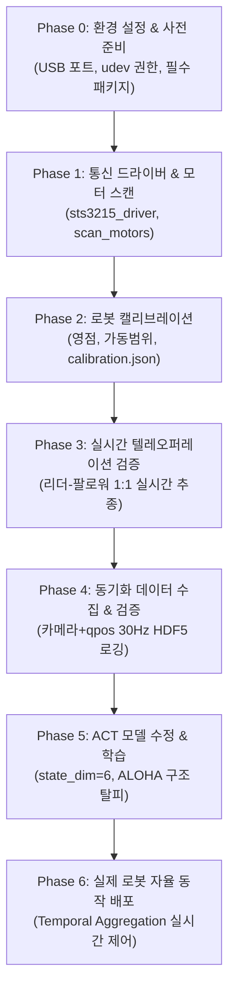

# SO-101 (SO-ARM100) 리더-팔로워 기반 ACT 모방학습 마스터 로드맵

이 문서는 **SO-101 로봇팔(6 DOF, Feetech STS3215 서보) 2대(리더-팔로워)**와 **RGB 카메라**를 활용하여 **ACT(Action Chunking with Transformers) 모방학습**을 성공적으로 수행하기 위한 전체 진행 가이드입니다.  
작업 중 길을 잃거나 문제가 발생했을 때 현재 단계와 다음 목표를 확인하는 이정표로 활용합니다.

---

## 📌 시스템 구성 요약

* **로봇 암**: SO-101 (6 DOF: 관절 5개 + 그리퍼 1개) × 2대
  * **Leader Arm (리더)**: 교시용 (토크 OFF 상태로 사람이 손으로 조작)
  * **Follower Arm (팔로워)**: 실제 작업용 (리더를 실시간 추종하거나 ACT 모델에 의해 제어)
* **모터 & 보드**: Feetech STS3215 스마트 시리얼 서보 모터, USB Bus Servo Driver Board (통신 속도: 1,000,000 bps)
* **비전(카메라)**:
  * 1단계: 외부 고정 RGB 카메라 1대 (`/dev/video4`)
  * 확장 예정: 손목 카메라 (Wrist Camera) 1대 추가 장착 (다중 카메라 인터페이스 구조 유지)
* **알고리즘**: ACT (Action Chunking with Transformers) + Temporal Ensembling

---

## 🗺️ 전체 진행 파이프라인 (Roadmap Overview)



---

## 📋 단계별 상세 내용 & 완료 기준 (DoD)

### [Phase 0] 사전 환경 준비
- [x] **USB 시리얼 포트 고정**:
  - 포트 권한 및 스캔 환경 확인 완료 (사용자 `dialout` 그룹 등록 확인)
- [x] **권한 부여**:
  - `jjj` 사용자가 `dialout` 그룹에 속해 있음 확인 (`groups` 확인 완료)
- [x] **필수 라이브러리 설치**:
  - `pyserial`, `h5py`, `tqdm`, `einops` 설치 및 정상 임포트 검증 완료
* **완료 기준**: 소프트웨어 및 패키지 환경 준비 완료.

---

### [Phase 1] 모터 통신 드라이버 및 점검
- [x] `sts3215_driver.py` 구현: Feetech STS3215 전용 경량 드라이버 완성 (Sync Write, Position Read, Status Read, Torque 제어 지원)
- [x] `scan_motors.py` 구현: 시리얼 포트 자동 탐색 및 모터 1~6번 상태(위치, 전압, 온도) 진단 도구 완성
- [x] 하드웨어 USB 연결 후 실제 모터 1~6번 응답 확인 완료:
  - `/dev/ttyACM0`: ID 1~6 모터 정상 응답 (전압 ~12.2V)
  - `/dev/ttyACM1`: ID 1~6 모터 정상 응답 (전압 ~7.6V)
* **완료 기준**: 총 12개 모터(리더 6개, 팔로워 6개)의 통신이 100% 정상 작동함을 확인.

---

### [Phase 2] 로봇 캘리브레이션 (Calibration)
- [x] `calibrate.py` 작성 및 실행 완료:
  - 1번~6번 관절 Zero Offset, Min/Max 가동 범위, 회전 방향 매핑 완료
  - 그리퍼(6번) 완전 열림/닫힘 범위 측정 완료
- [x] `calibration.json` 저장 완료:
  - Leader 포트: `/dev/ttyACM1`, Follower 포트: `/dev/ttyACM0`
* **완료 기준**: `calibration.json` 파일 생성 및 수치 검증 완료.

---

### [Phase 3] 실시간 텔레오퍼레이션 (Leader-Follower 추종)
- [x] `teleop.py` 구현 및 실시간 추종 테스트 완료:
  - Leader 팔 토크 OFF (수동 조작), Follower 팔 토크 ON (실시간 50Hz 정밀 추종)
  - 1:1 관절 각도 매핑 및 그리퍼 개폐 비율 정밀 동기화 완료
  - 종료 시 브로드캐스트 + 5ms 안전 간격으로 1~6번 전 모터 토크 완전 해제 검증 완료
* **완료 기준**: 리더를 조작했을 때 팔로워가 지연(lag)과 떨림 없이 자연스럽게 따라오며, 안전 종료 확인.

---

### [Phase 4] 멀티모달 데이터 수집 (Data Collection)
- [x] `camera_interface.py`: 멀티스레드 기반 제로 지연 캡처 인터페이스 (Top + Wrist 듀얼 카메라 동시 스트리밍 지원)
- [x] `record_episodes.py` 구현 완료:
  - 텔레오퍼레이션 실시간 조작 기반 30Hz 데이터 수집기
  - `top` + `wrist` RGB 영상 (480x640x3) + `qpos(6)` + `action(6)` + `qvel(6)`을 ACT 표준 HDF5 형식으로 동기화 저장
  - 실시간 HUD 프리뷰 창, 조기 완료 시 최종 자세 자동 패딩 (`pad_to_max`), 성공/실패 여부에 따른 즉시 저장/폐기 기능
  - 종료 시 브로드캐스트 + 개별 지연 토크 해제 안전 로직 적용
- [x] `visualize_data.py` 구현 완료:
  - HDF5 무결성 검사 (NaN/Inf, 텐서 크기, 리더-팔로워 추종 오차 검사)
  - Top & Wrist 멀티뷰 비디오 합성 (MP4) 및 HUD 오버레이
  - 6관절 qpos vs action 궤적 비교 및 오차 분석 그래프 (PNG)
  - OpenCV 기반 대화형 비디오 플레이어 (Space/방향키 프레임 탐색) 및 데이터셋 일괄 검증 (`--all`)
- [x] 실제 픽앤플레이스 데모 데이터 수집 완료:
  - 총 32개 에피소드 수집 (누적 15,318 스텝, 약 8.5분 분량)
  - HDF5 무결성 일괄 검증 100% 통과 (결함/경고 0건, 전 에피소드 정상 PASS)
* **완료 기준**: 최소 30~50개 이상의 고품질 데모 HDF5 데이터셋 확보 완료. (32개 확보)

---

### [Phase 5] ACT 모델 차원 수정 및 학습
- [x] 독립 패키지 `so101_act/` 구현 완료 (`act/` 원본 리포지토리 100% 무수정 보존):
  - `so101_act/models/`: CVAE 인코더, DETR 디코더, ResNet18 백본, 2D Sinusoidal 위치 임베딩 (SO-101 6-DOF 및 듀얼 카메라 전용)
  - `so101_act/dataset.py`: HDF5 데이터 로더 (32개 에피소드 동적 패딩 `is_pad` 및 정규화 통계 산출)
  - `so101_act/train.py` 및 `train.sh`: L1 + KL 발산 복합 손실, 검증 손실(Val Loss) 기준 `policy_best.ckpt` 자동 저장
- [ ] 모델 학습 실행 (`./train.sh`):
  ```bash
  ./train.sh --epochs 2000 --batch-size 8 --chunk-size 50
  ```
- [ ] 검증 손실(Validation loss) 및 L1/KL 손실 수렴 확인
* **완료 기준**: `ckpt/so101_act/policy_best.ckpt` 모델 가중치 파일 생성 완료.

---

### [Phase 6] 실제 로봇 배포 및 자율 동작 평가 (Inference)
- [x] `so101_act/deploy_real_robot.py` 및 `deploy.sh` 구현 완료:
  - 학습된 `policy_best.ckpt` 및 `dataset_stats.pkl` 로드
  - Top + Wrist 듀얼 카메라 실시간 피드 + Follower 로봇 현재 qpos 기반 추론
  - **Temporal Aggregation (지수 가중 앙상블)** 적용하여 모터 떨림(Jitter) 원천 차단
  - 실시간 안전 정지 (종료 시 100% 토크 해제)
- [ ] 실제 로봇 자율 픽앤플레이스 구동 테스트 (`./deploy.sh`)
- [ ] 성공률 테스트 및 물체 위치 변화에 대한 일반화 성능 확인
* **완료 기준**: 조작자의 개입 없이 로봇이 카메라 영상만 보고 작업을 100% 자율 수행.

---

## 🛠️ 추후 손목 카메라(Wrist Camera) 추가 시 체크포인트

손목 카메라가 추가될 경우 전체 파이프라인 중 변경해야 하는 부분은 아래 3곳으로 한정됩니다:
1. `config.py`: `camera_names = ['top', 'wrist']` 및 카메라 장치 인덱스 추가
2. `record_episodes.py`: HDF5 파일의 `observations/images/wrist` 데이터셋 추가 기록
3. ACT 재학습: ResNet 백본이 자동으로 2개 카메라 피처를 결합하도록 입력 차원 자동 매핑

---

## 📂 최종 파일 구조 (완성 시점 예상)

```
Robot_Arm_Project/
├── ROADMAP.md                  # [현재 문서] 전체 진행 기준표
├── config.py                   # 로봇/카메라/포트/파라미터 공통 설정
├── calibration.json            # Phase 2 결과물 (영점, 한계값 매핑)
├── camera.py                   # 카메라 단독 테스트 툴
├── sts3215_driver.py           # Feetech 서보 통신 드라이버
├── scan_motors.py              # 모터 핑 및 ID 진단 툴
├── calibrate.py                # 캘리브레이션 도구
├── teleop.py                   # 리더-팔로워 1:1 추종 스크립트
├── record_episodes.py          # 데모 데이터 수집 스크립트
├── visualize_data.py           # 수집 데이터 검증 툴
├── eval_real_robot.py          # ACT 실시간 자율 구동 스크립트
├── data/                       # HDF5 에피소드 데이터셋 저장 폴더
├── ckpt/                       # 학습된 모델 가중치 저장 폴더
└── act/                        # ACT 모델 및 백본 소스코드
```

---

*이 로드맵은 각 단계가 완료될 때마다 체크박스([x])를 업데이트하며 진행할 수 있습니다.*
